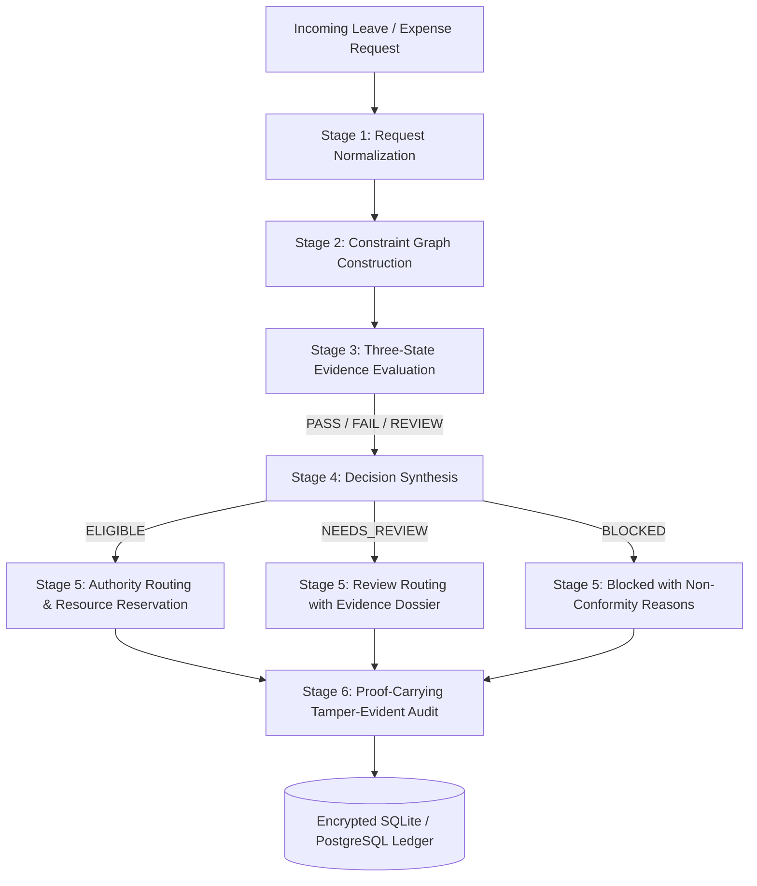

# LeaveFlow
## Evidence-First Constraint Graph (EFCG) Platform
### Intelligent Workforce Leave & Expense Management Automation

> **"Every Request. Every Decision. Every Reason."**  
> *Intelligent workforce operations powered by explainable decisions.*

---

## 1. Executive Summary & Identity

**LeaveFlow** is an enterprise SaaS platform that unifies Leave Management and Expense Management into a single, explainable decision pipeline.

Traditional HR and Expense tools process requests using opaque boolean filters, resulting in errors like overdrawn balances, overlapping approved dates, duplicate receipts, split invoice avoidance, and zero audit traceability.

LeaveFlow replaces opaque logic with a custom **Evidence-First Constraint Graph (EFCG)**. Instead of treating requests as isolated boolean conditions, every request is represented as an interconnected set of business constraints. Each constraint evaluates independently into three distinct states (`PASS`, `FAIL`, `REVIEW`), accumulates verifiable empirical proof, and synthesizes an explainable outcome (`ELIGIBLE`, `NEEDS_REVIEW`, `BLOCKED`).

Resource allocations are managed through an atomic **Resource Reservation Ledger**, while every operational action produces a tamper-evident, append-only **SHA-256 Hash Audit Block** forming an application-level hash-linked audit chain.

---

## 2. Core Architectural Innovation: The EFCG Pipeline



### The 6 Stages of EFCG
1. **Stage 1: Request Normalization**: Normalizes varied inputs into typed, canonical schema representations with temporal boundaries and decimal financial precision.
2. **Stage 2: Constraint Graph Construction**: Dynamically constructs a directed acyclic graph (DAG) of policy nodes and dependency edges (e.g. `EmployeeActive` $\rightarrow$ `EmploymentDates` $\rightarrow$ `PolicyEligibility` $\rightarrow$ `WorkingDays` $\rightarrow$ `BalanceCheck` $\rightarrow$ `OverlapCheck` $\rightarrow$ `AuthorityRouting`).
3. **Stage 3: Evidence Evaluation**: Evaluates each node independently, assigning:
   - `PASS`: Condition cleanly verified with empirical proof.
   - `FAIL`: Clear policy violation (e.g., negative balance, duplicate receipt hash collision, date outside employment).
   - `REVIEW`: Ambiguous condition, missing optional attachment, unassigned cost center, or potential split claim needing human discretion.
4. **Stage 4: Decision Synthesis**: Combines graph results:
   - Any blocking `FAIL` $\rightarrow$ `BLOCKED`.
   - No `FAIL`, but $\ge 1$ `REVIEW` $\rightarrow$ `NEEDS_REVIEW`.
   - All pass $\rightarrow$ `ELIGIBLE`.
   - Generates plain-language, natural language explanation detailing exact metrics and conditions.
5. **Stage 5: Authority Routing & Resource Reservation**:
   - Traverses organizational reporting hierarchy (Manager $\rightarrow$ Department Head $\rightarrow$ Finance), strictly enforcing **Zero Self-Approval**.
   - Atomically holds required days or dollars in the **Resource Reservation Ledger**.
6. **Stage 6: Proof-Carrying Audit**:
   - Records an immutable SHA-256 block referencing predecessor hash ($H_i = \text{SHA256}(H_{i-1} + \dots)$) storing full canonical payload.

---

## 3. Implemented Core Algorithms

| Algorithm | Implementation File | Key Mechanism & Guarantees |
| :--- | :--- | :--- |
| **A. Interval Overlap Detection** | `backend/app/engines/algorithms/interval_overlap.py` | Detects overlapping date intervals $[A, B] \cap [C, D]$ for an employee against existing non-cancelled bookings. |
| **B. Rolling-Window Split Claims** | `backend/app/engines/algorithms/split_claim.py` | Detects transaction clustering (merchant or category) within a configurable window (7 days) where sum exceeds threshold ($1,000) while individual claims stay under. Flagged as `REVIEW`, never automatic fraud. |
| **C. SHA-256 Duplicate Receipts** | `backend/app/engines/algorithms/receipt_duplicate.py` | Hashes receipt bytes via SHA-256; detects duplicate claims across active records. |
| **D. Authority Graph Traversal** | `backend/app/engines/algorithms/authority_traversal.py` | Traverses employee $\rightarrow$ manager $\rightarrow$ department head $\rightarrow$ finance. Strictly forbids `approver_id == applicant_id`. |
| **E. Resource Reservation Ledger** | `backend/app/engines/reservation/ledger.py` | Atomic DB transactions reserve balances upon submission/eligibility, release on reject/cancel, and commit upon final approval. Prevents double allocation. |
| **F. Policy Constraint Evaluation** | `backend/app/engines/constraint_graph/builder.py` | Verifies per-claim caps, grade minimums, tenure dates, and budget headroom. |
| **G. Tamper-Evident Hash Audit** | `backend/app/engines/audit/service.py` | Append-only block chain ($H_i = \text{SHA256}(H_{i-1} + \dots)$) with verification endpoint detecting payload changes or broken links. Safe under concurrency. |
| **H. Business Day & Holiday Calc** | `backend/app/engines/algorithms/business_days.py` | Calculates working days excluding Saturdays, Sundays, and statutory dates in `Holiday` table. |

---

## 4. Demo User Accounts (1-Click Switcher)

All demo accounts use password: `Password123!`

| Role | Name & Title | Email Address | Access Level & Capabilities |
| :--- | :--- | :--- | :--- |
| **Employee** | Sarah Connor (L3 Staff) | `employee@leaveflow.internal` | Apply leave, submit expenses with receipt hashing, track requests. |
| **Manager** | David Kim (L4 Manager) | `manager@leaveflow.internal` | Review team leave & expense queues, approve/reject/request-info with comments. |
| **Finance** | Claire Redfield (Finance Head) | `finance@leaveflow.internal` | Review high-value claims, monitor department budgets, disburse ACH reimbursements. |
| **Process Owner** | Marcus Sterling (HR Policy) | `process.owner@leaveflow.internal` | Configure leave & expense policy thresholds, holiday calendar, rule versioning. |
| **Admin** | Eleanor Vance (System Exec) | `admin@leaveflow.internal` | Full organization directory, run anomaly surveillance scans, verify audit hash integrity. |

*Note: In the web application, a persistent **1-Click Persona Switcher** is present in the top navigation bar and login screen to effortlessly switch between roles.*

---

## 5. Getting Started on Windows

### 1-Click Launch (Easiest for Reviewers)
- **Start Platform**: Double-click `start_leaveflow.bat` (opens both Backend on :8000 and Frontend on :5173).
- **Run Tests**: Double-click `run_tests.bat` (runs all 14 Pytest verification tests).

### Prerequisites
- Python 3.11+
- Node.js v18+ & npm
- Git

### Manual Installation & Startup Commands

```powershell
# 1. Clone repository & enter directory
git clone https://github.com/MVarshitha843/LeaveFlow.git
cd LeaveFlow

# 2. Setup Backend Python Virtual Environment
py -3.11 -m venv backend\venv
backend\venv\Scripts\python.exe -m pip install -r backend\requirements.txt
backend\venv\Scripts\python.exe -m pip install email-validator

# 3. Seed Deterministic Database (Starter or Full Mode)
backend\venv\Scripts\python.exe scripts\generate_data.py --mode full --seed 20261022

# 4. Install Frontend Dependencies
cd frontend
npm install
cd ..

# 5. Start Backend Server (Port 8000)
backend\venv\Scripts\python.exe -m uvicorn backend.app.main:app --host 127.0.0.1 --port 8000 --reload

# 6. Start Frontend Server (In a second terminal, Port 5173)
cd frontend
npm run dev
```

- **Frontend Application URL**: [http://localhost:5173](http://localhost:5173)
- **Backend API & Swagger Docs**: [http://localhost:8000/docs](http://localhost:8000/docs)

---

## 6. Automated Pytest Verification Suite

Run the comprehensive test suite covering all core algorithms, reservation mechanics, audit chains, and end-to-end lifecycles:

```powershell
backend\venv\Scripts\python.exe -m pytest backend/tests -v
```

### Test Suite Execution Output
```
backend/tests/test_efcg_core.py::test_business_days_with_holidays PASSED
backend/tests/test_efcg_core.py::test_interval_overlap_detection PASSED
backend/tests/test_efcg_core.py::test_split_claim_suspicious_detector PASSED
backend/tests/test_efcg_core.py::test_receipt_duplicate_detection PASSED
backend/tests/test_efcg_core.py::test_authority_graph_zero_self_approval PASSED
backend/tests/test_efcg_core.py::test_efcg_leave_graph_evaluation PASSED
backend/tests/test_ledger_and_audit.py::test_leave_reservation_commit_and_release PASSED
backend/tests/test_ledger_and_audit.py::test_prevent_double_allocation_or_overdraw PASSED
backend/tests/test_ledger_and_audit.py::test_tamper_evident_audit_chain_verification PASSED
backend/tests/test_ledger_and_audit.py::test_audit_chain_tamper_detection PASSED
backend/tests/test_e2e_scenarios.py::test_scenario_a_leave_lifecycle_complete PASSED
backend/tests/test_e2e_scenarios.py::test_scenario_b_expense_lifecycle_complete PASSED
backend/tests/test_e2e_scenarios.py::test_scenario_c_split_claims_detected_and_reviewed PASSED
backend/tests/test_e2e_scenarios.py::test_scenario_d_missing_receipt_request_info PASSED

======================= 14 passed in 0.42s =======================
```

---

## 7. Suggested Hackathon Demo Flow (3–5 Minutes)

1. **Sign In**: Navigate to `http://localhost:5173/login`. Use the 1-click **"Employee Portal"** button.
2. **Submit Leave Application**: Go to **Apply Leave**. Select `Annual Leave`, dates covering a weekend and holiday. Notice the live business days breakdown and EFCG pre-validation badge. Submit the request.
3. **Inspect Interactive EFCG Visualizer**: Click **Interactive Graph**. Zoom, pan, and click constraint nodes (`Schedule Overlap Verification`, `Leave Balance Availability`, `Working Day Calculation`) to inspect the evidence inspector side drawer.
4. **Switch to Manager Portal**: Click the active role pill in the top header and switch to **Manager Portal**. Open the **Approval Queue**, review Sarah Connor's leave request, and click **Approve**.
5. **Verify Reservation Commitment**: View request tracking. Notice status moved to `APPROVED`, reservation ledger committed the deduction, and audit log recorded the hash-linked approval block.
6. **Detect Anomaly (Split Claim / Duplicate Receipt)**: Switch to **Finance Portal** and open the **Anomaly Review Queue**. Inspect `EXP-2026-990002` (Duplicate receipt SHA-256 collision) or `EXP-2026-990004` (Rolling-window split claim pattern).
7. **Verify Audit Chain Integrity**: Navigate to **Audit Hash Ledger**. Click **Verify Chain Integrity** to observe the tamper-evident SHA-256 hash-chain integrity check in real-time.
8. **Export Operational Reports**: Navigate to **Reports & Exports** and download clean CSVs of leaves, expenses, and audit events.

---

## 8. License & Authorship

Built by the LeaveFlow Engineering Team for the Leaveflow Challenge.  
Architecture: Evidence-First Constraint Graph (EFCG).  
License: Not yet specified.
