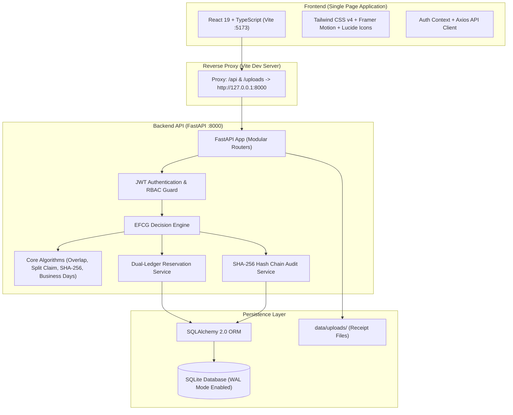
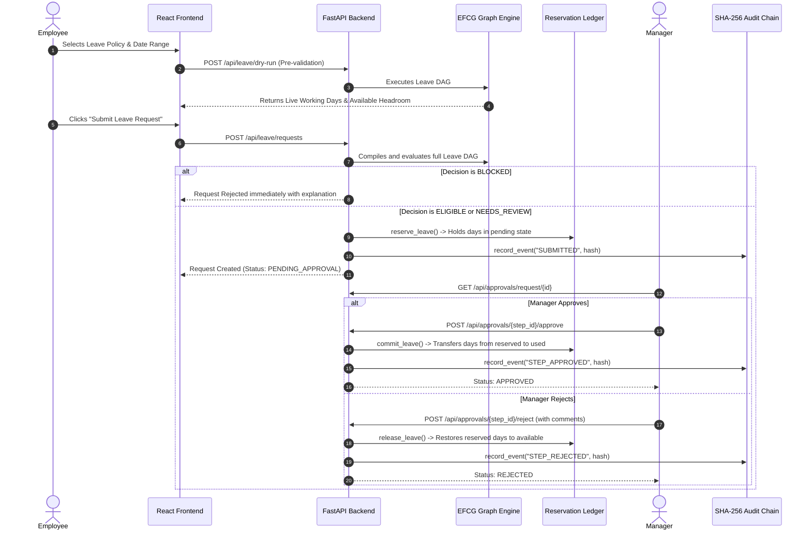
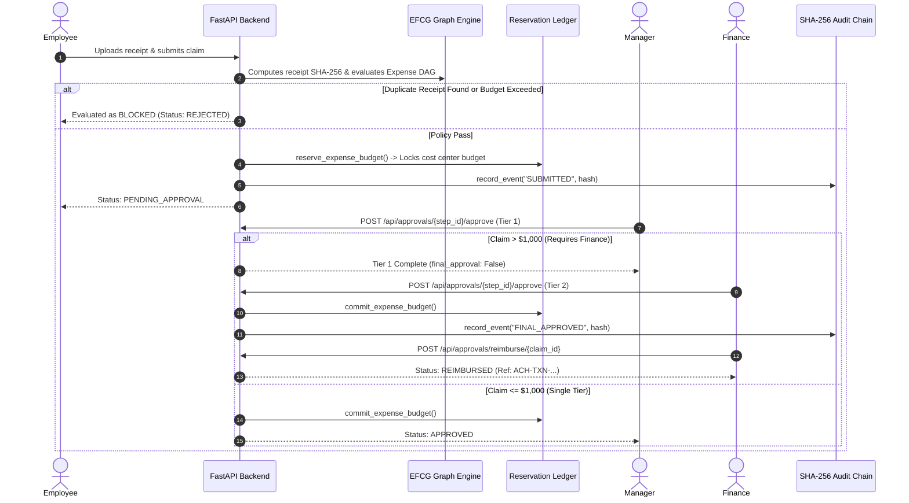

# LeaveFlow — System Architecture

> **Document Scope**: Complete technical architecture and execution flow of the LeaveFlow platform.
> **Audience**: Hackathon evaluators, technical reviewers, and developers.
> **Author Style**: Clear, practical explanation of what is actually implemented in the codebase.

---

## 1. What is LeaveFlow?

**LeaveFlow** is an enterprise workforce operations platform that combines **Leave Management** and **Expense Management** into a single system.

In traditional enterprise software, leave tracking and expense approvals are handled by separate tools using basic `if/else` checks. This leads to common real-world problems:
- Employees accidentally overdraw leave balances because approvals take days and balances aren't reserved.
- Overlapping leaves are approved because the system doesn't check calendar collision intervals.
- The same receipt image is uploaded for multiple expense claims without being detected.
- Employees split a large bill (e.g. two $600 receipts instead of one $1,200 receipt) to avoid higher approval tiers.
- When a request is rejected, the employee receives an unhelpful generic error with zero explanation.
- Audit logs are stored in standard database tables where any administrator can alter history without detection.

LeaveFlow solves these problems using an **Evidence-First Constraint Graph (EFCG)**. Instead of treating policy checks as a black box, LeaveFlow represents every business rule as an explicit node in a Directed Acyclic Graph (DAG). Each node evaluates with verifiable empirical proof into `PASS`, `FAIL`, or `REVIEW`, holds resources safely in an atomic reservation ledger, and records every operational action into a cryptographic SHA-256 hash chain.

---

## 2. Overall System Architecture

LeaveFlow is built as a modern, decoupled client-server application:



### Responsibilities:
1. **Frontend (`frontend/`)**: Single-page application built with React 19, TypeScript, and Vite. Handles user interaction, form dry-run feedback, interactive graph rendering, 1-click demo persona switching, and dynamic White + Blue dashboards.
2. **Backend (`backend/app/`)**: High-performance REST API built with Python 3.11 and FastAPI. Handles JWT authentication, evaluates constraint graphs, enforces organizational hierarchies, detects anomalies, manages atomic balance reservations, and maintains the audit ledger.
3. **Database (`data/leaveflow.db`)**: Relational database accessed via SQLAlchemy 2.0. Uses **SQLite Write-Ahead Logging (WAL) mode** to support concurrent reads and writes without database lock contention.
4. **Receipt Storage (`data/uploads/`)**: Local filesystem storage for uploaded receipt attachments, served as static files via FastAPI's `StaticFiles` mount at `/uploads`.

---

## 3. How Frontend Communicates with Backend

The frontend and backend run as separate local processes:
- **Backend**: Runs on `http://127.0.0.1:8000` via Uvicorn.
- **Frontend**: Runs on `http://localhost:5173` via Vite.

To prevent Cross-Origin Resource Sharing (CORS) friction and simplify API calls, Vite is configured with an internal reverse proxy in [frontend/vite.config.ts](file:///e:/Leaveflow_Assignment/frontend/vite.config.ts):

```typescript
export default defineConfig({
  plugins: [react(), tailwindcss()],
  server: {
    port: 5173,
    proxy: {
      '/api': {
        target: 'http://localhost:8000',
        changeOrigin: true
      },
      '/uploads': {
        target: 'http://localhost:8000',
        changeOrigin: true
      }
    }
  }
})
```

- When the frontend calls `/api/leave/requests`, Vite proxies the request behind the scenes to `http://localhost:8000/api/leave/requests`.
- The user's JWT token is saved in browser `localStorage` under `leaveflow_token` upon login and automatically attached to the `Authorization: Bearer <token>` header on every request via an Axios interceptor in [frontend/src/services/api.ts](file:///e:/Leaveflow_Assignment/frontend/src/services/api.ts).

---

## 4. Main Backend Modules and Structure

The backend source code in `backend/app/` is organized into clean, single-responsibility modules:

```
backend/app/
├── api/                   # REST API Routers
│   ├── auth.py            # Login, demo accounts, profile (/api/auth)
│   ├── employees.py       # Staff directory, departments, cost centers
│   ├── leave.py           # Leave requests, dry-run checks, policies
│   ├── expenses.py        # Expense claims, receipt upload, policy caps
│   ├── approvals.py       # Multi-tier queue, approve/reject/request-info
│   ├── decision.py        # Constraint graph visualization data
│   ├── reservations.py    # Resource reservation ledger inspection
│   ├── anomalies.py       # Surveillance alerts and anomaly reviews
│   ├── audit.py           # Hash-chain events and verification endpoint
│   ├── reports.py         # Streaming CSV exports (leaves, expenses, audit)
│   └── notifications.py   # In-app notifications
├── core/
│   ├── config.py          # Environment settings, secret keys, file paths
│   ├── database.py        # SQLAlchemy engine, session maker, WAL pragmas
│   └── security.py        # JWT token generation and bcrypt password hashing
├── engines/               # Core Intelligence & Business Logic
│   ├── algorithms/
│   │   ├── authority_traversal.py  # Hierarchy routing with zero self-approval
│   │   ├── business_days.py        # Working days minus weekends & holidays
│   │   ├── interval_overlap.py     # Date collision detection: [A,B] ∩ [C,D]
│   │   ├── receipt_duplicate.py    # SHA-256 receipt fingerprinting
│   │   └── split_claim.py          # Rolling-window threshold avoidance detector
│   ├── constraint_graph/
│   │   ├── node.py                 # ConstraintNode and EvidenceRecord classes
│   │   └── builder.py              # Assembles Leave & Expense DAGs
│   ├── decision/
│   │   └── synthesizer.py          # Aggregates node outcomes & generates text
│   ├── reservation/
│   │   └── ledger.py               # Atomic balance & budget holds/releases
│   ├── audit/
│   │   └── service.py              # SHA-256 block chain creation & verify
│   └── anomaly/
│       └── detector.py             # Periodic & on-demand anomaly scans
└── models/                # SQLAlchemy Relational Models (20 tables)
```

---

## 5. The Evidence-First Constraint Graph (EFCG) Architecture

The core innovation of LeaveFlow is the **Evidence-First Constraint Graph (EFCG)**.

### Why a Graph?
In a typical system, rules are evaluated sequentially in hardcoded code blocks. If rule 3 fails, the system aborts without checking rules 4, 5, or 6. If policies depend on one another, changing one rule breaks others silently.

In LeaveFlow, policy checks are modeled as explicit nodes in a Directed Acyclic Graph (DAG). Nodes declare their dependencies (for example, *Leave Balance Check* depends on *Working Days Calculation*, which in turn depends on *Corporate Holiday Exclusion*). The engine uses **Kahn's Algorithm (Topological Sort)** to determine the exact execution order.

### The 3 Evaluation States:
Each node evaluates to one of three states:
1. `PASS`: Condition is completely satisfied. The node captures empirical evidence (e.g. *"Requested 3.0 days <= 16.0 days available balance"*).
2. `FAIL`: A hard policy violation that blocks the request (e.g. *"Employee has 2.0 days remaining but requested 5.0 days"*).
3. `REVIEW`: A soft boundary, missing optional attachment, or suspicious pattern that does not warrant an immediate rejection but requires human discretion (e.g. *"Claim amount of $1,200.00 exceeds single manager sign-off threshold ($1,000.00)"*).

### Decision Synthesis:
Once all nodes in the graph are executed, the decision synthesizer combines the results into an overall state:
- If **any blocking node fails** $\rightarrow$ **`BLOCKED`** (request is rejected).
- If **zero blocking nodes fail, but $\ge 1$ node returns REVIEW** $\rightarrow$ **`NEEDS_REVIEW`** (routed to manager/finance with an evidence dossier).
- If **all nodes return PASS** $\rightarrow$ **`ELIGIBLE`** (automatically ready for standard manager sign-off).

The synthesizer also generates a clear natural-language explanation detailing exactly why the request received that decision.

---

## 6. Leave Request Processing Flow

Here is how a leave request moves through the system from start to finish:



### Leave Constraint Nodes:
1. `NODE_EMP_ACTIVE`: Checks if the applicant holds an `ACTIVE` employment status.
2. `NODE_EMPLOYMENT_DATES`: Verifies request dates do not precede hire date or follow termination date.
3. `NODE_POLICY_ELIGIBILITY`: Verifies employee grade meets minimum policy grade and request does not exceed `max_consecutive_days`.
4. `NODE_WORKING_DAYS`: Excludes weekends and corporate holidays from the interval.
5. `NODE_BALANCE_CHECK`: Verifies available headroom: $\text{Allocated} - (\text{Used} + \text{Reserved}) \ge \text{Requested}$.
6. `NODE_OVERLAP_CHECK`: Checks for intersecting date ranges with other active or pending leave requests.
7. `NODE_DOCUMENTATION`: Checks if medical or official documentation is required for long durations.
8. `NODE_AUTHORITY_CHECK`: Traverses reporting hierarchy to find the supervisor, strictly enforcing **Zero Self-Approval**.

---

## 7. Expense Claim Processing Flow



### Expense Constraint Nodes:
1. `NODE_EMP_ACTIVE`: Applicant must be active.
2. `NODE_EMPLOYMENT_DATES`: Expense date must fall within employment tenure.
3. `NODE_COST_CENTER`: Applicant must be assigned to the designated cost center.
4. `NODE_POLICY_LIMIT`: Claim amount must stay within per-claim policy ceilings.
5. `NODE_RECEIPT_VERIFICATION`: Checks if receipt file is attached when required by policy.
6. `NODE_RECEIPT_DUPLICATE`: Compares receipt SHA-256 fingerprint against all historical claims.
7. `NODE_SPLIT_CLAIM`: Scans 7-day rolling window to detect micro-claim clusters evading $1,000 approval thresholds.
8. `NODE_BUDGET_CHECK`: Verifies cost center has sufficient unreserved budget headroom.
9. `NODE_AUTHORITY_CHECK`: Determines single-tier (Manager) vs dual-tier (Manager + Finance) sign-off.

---

## 8. Dual-Ledger Resource Reservation

A major bug in legacy HR platforms is the **double-spending race condition**:
> *Example*: An employee has 3 days of leave balance remaining. At 9:00 AM, they submit Request A for 3 days. At 9:05 AM, before their manager reviews Request A, they submit Request B for 3 days. If the system only deducts balance upon approval, both requests pass validation! Once the manager approves both, the employee has taken 6 days on a 3-day balance.

LeaveFlow prevents this using a **Dual-Ledger Reservation System** implemented in [backend/app/engines/reservation/ledger.py](file:///e:/Leaveflow_Assignment/backend/app/engines/reservation/ledger.py):

$$\text{Available Balance} = \text{Allocated Days} - (\text{Used Days} + \text{Reserved Days})$$

1. **On Submission**: If available balance $\ge$ requested days, the engine inserts a row into `resource_reservations` with status `RESERVED` and increments `leave_balances.reserved_days`. The headroom drops immediately. Any subsequent submission sees zero available headroom and is blocked.
2. **On Manager Approval**: The reservation status changes to `COMMITTED`. The reserved amount is moved to `used_days`, and `reserved_days` is decremented.
3. **On Manager Rejection or Cancellation**: The reservation status changes to `RELEASED`. The reserved amount is removed from `reserved_days`, immediately restoring the employee's available balance.

The exact same atomic pattern is applied to department expense budgets in `cost_centers.reserved_budget` and `cost_centers.current_spend`.

---

## 9. Cryptographic Audit Trail (SHA-256 Hash Chain)

To guarantee that internal audit records cannot be modified or deleted without detection, LeaveFlow implements an **application-level cryptographic hash chain** in [backend/app/engines/audit/service.py](file:///e:/Leaveflow_Assignment/backend/app/engines/audit/service.py).

Every operational event (request submission, node evaluation, approval sign-off, rejection, or reimbursement) produces an immutable record in the `audit_events` table:

```
[Genesis Block: prev_hash = "0000...0000"]
       │
       â–¼
[Block 1: H_1 = SHA-256(H_0 + Timestamp + Actor + Action + Payload)]
       │
       â–¼
[Block 2: H_2 = SHA-256(H_1 + Timestamp + Actor + Action + Payload)]
       │
       â–¼
[Block n: H_n = SHA-256(H_{n-1} + Timestamp + Actor + Action + Payload)]
```

### Verification Endpoint (`GET /api/audit/verify`):
When an auditor or administrator triggers verification, the backend reads all events ordered by sequential ID. For each event:
1. It verifies that `event.previous_hash` matches the `current_hash` of the preceding record.
2. It re-calculates the expected SHA-256 hash from the event's actual payload fields.
3. If an attacker manually edited a database row (e.g. changing an approved amount or approver name), the recomputed hash will not match `current_hash`, and the API immediately flags `PAYLOAD_TAMPERED` along with the exact corrupted event ID.

---

## 10. Technologies and Dependencies Actually Used

| Layer | Technology | Version | Purpose in LeaveFlow |
| :--- | :--- | :--- | :--- |
| **Backend Runtime** | Python | 3.11+ | Backend execution environment |
| **API Framework** | FastAPI | 0.110.0+ | Fast asynchronous REST API with automatic OpenAPI documentation |
| **ASGI Server** | Uvicorn | 0.28.0+ | Asynchronous server hosting the FastAPI application |
| **ORM / Data Access** | SQLAlchemy | 2.0.28+ | Type-safe database queries and relationship mapping |
| **Validation** | Pydantic & Pydantic-Settings | 2.6.4+ | Request and response schema parsing and input validation |
| **Security** | passlib (bcrypt), python-jose | 1.7.4+ | Password hashing and JWT token creation/decoding |
| **Email Validation** | email-validator | 2.1.0+ | Strict email address validation for user registrations |
| **Database** | SQLite (WAL Mode) | 3.x | Local zero-configuration relational database with WAL concurrency |
| **Synthetic Data** | Faker | 24.0.0+ | Deterministic employee profiles and company names generation |
| **Testing** | Pytest & HTTPX | 8.0.0+ | Automated unit, integration, and end-to-end lifecycle test runner |
| **Frontend Runtime** | Node.js | v18+ | JavaScript / TypeScript build runtime |
| **Build Tool** | Vite | 8.3.8 | Ultra-fast client development server and production bundler |
| **UI Library** | React | 19.3.1 | Declarative component rendering and state management |
| **Language** | TypeScript | 5.8+ | Type safety and interface contracts across the frontend |
| **Styling** | Tailwind CSS | 4.3.5 | Modern utility-first CSS styling and custom design system |
| **Icons** | Lucide React | 1.72.0 | Consistent modern iconography across all dashboards |
| **Animations** | Framer Motion | 14.12.0 | Smooth micro-interactions, modal transitions, and card hovers |
| **Charts** | Recharts | 3.10.1 | Visual data charts for leave utilization and expense budgets |
| **HTTP Client** | Axios | 1.21.1 | API communication and authentication interceptors |
| **Routing** | React Router DOM | 7.18.5 | Client-side routing across all 14 application views |
